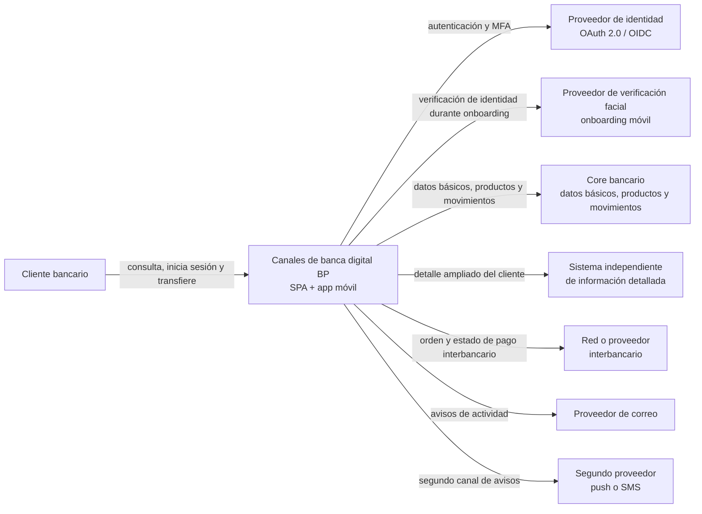
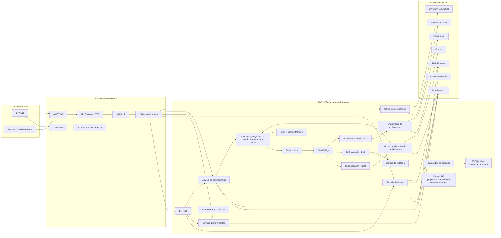
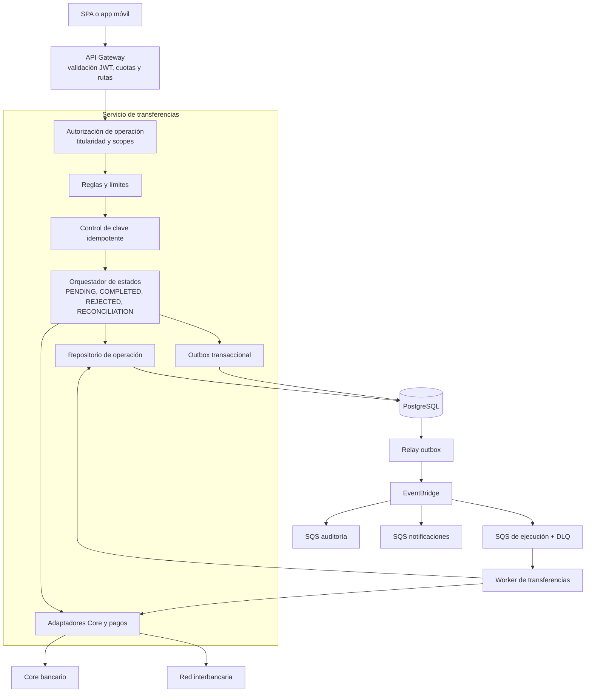
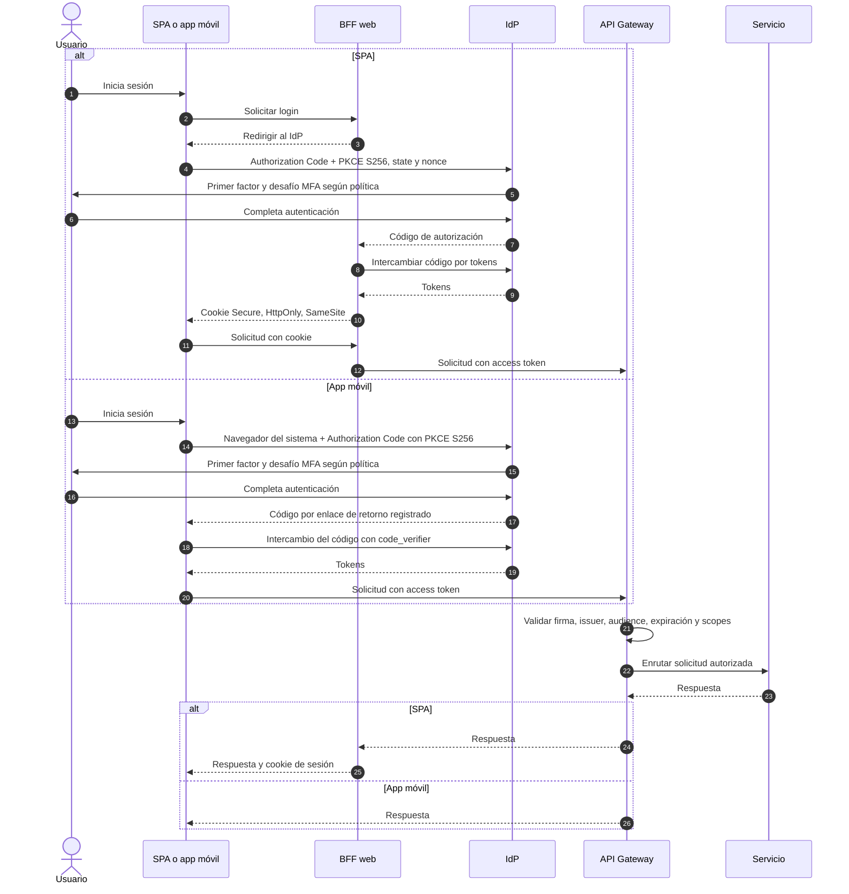
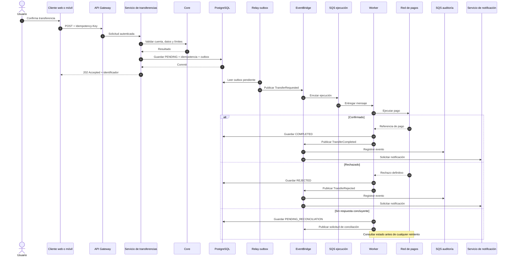
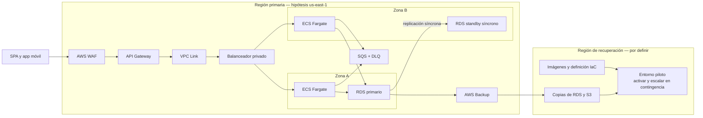

# Arquitectura propuesta para banca digital BP

> **Estado:** avance del MVP. Los elementos exigidos por el enunciado se separan de las recomendaciones de diseño. La región `us-east-1` es una hipótesis de cálculo, no una decisión de residencia de datos.

## 1. Requisitos del MVP y recomendaciones

| Origen | Elementos |
|---|---|
| Enunciado | SPA y aplicación móvil multiplataforma; OAuth 2.0; onboarding móvil con reconocimiento facial; Core y sistema independiente de información detallada; consulta de datos básicos y movimientos; transferencias propias e interbancarias; dos o más mecanismos de notificación; auditoría; persistencia para clientes frecuentes; API Gateway; alta disponibilidad, recuperación, seguridad y monitoreo. |
| Recomendación de diseño | AWS; React Native con Expo (a validar frente a Flutter); BFF para SPA; API HTTP; ECS Fargate; PostgreSQL Multi-AZ; DynamoDB como proyección de lectura; EventBridge/SQS; patrón outbox; servicio de auditoría y archivo protegido; DR con copias en región secundaria. |

La SPA y la app móvil son dos clientes del MVP y comparten los servicios backend. La PWA se documenta como alternativa sugerida por el profesor, no como reemplazo automático de la app móvil en el diseño base.

## Marco normativo y controles de cumplimiento

La jurisdicción de BP aún debe confirmarse; por ello, esta sección es una base de análisis y no una conclusión legal. Si BP opera en Ecuador, el diseño debe validarse, como mínimo, contra:

- **LOPDP y su Reglamento General:** definir base legitimadora y finalidad del tratamiento, minimización y retención, atención de derechos, contratos con encargados, transferencias internacionales y salvaguardas para datos biométricos del onboarding. Aplicar privacidad desde el diseño y evaluar formalmente el riesgo del tratamiento facial.
- **Normativa de la Superintendencia de Bancos:** revisar la Codificación de Normas de Control vigente, en particular la gestión del riesgo operativo, seguridad de información y ciberseguridad, continuidad del negocio, canales electrónicos y servicios provistos por terceros. El control de incidentes debe contemplar detección, registro, respuesta, recuperación y notificación regulatoria cuando corresponda.
- **Protección al consumidor financiero:** informar condiciones, costos, estados y mecanismos de reclamo; conservar trazabilidad de instrucciones y operaciones.
- **PCI DSS:** incluirlo en el análisis únicamente si el alcance procesa, transmite o almacena datos de tarjetas o afecta el entorno de datos de tarjeta.

Como marcos de apoyo técnico se pueden mapear controles a ISO/IEC 27001/27002 y NIST CSF; no sustituyen las obligaciones regulatorias. Legal y Cumplimiento deben confirmar aplicabilidad, versiones vigentes, plazos de retención, residencia de datos y notificación de incidentes antes de producción.

Referencias oficiales para la hipótesis Ecuador: [SPDP - normativa de protección de datos](https://www.spdp.gob.ec/docs/proteccion-de-datos-personales/general/normativa/), [Superintendencia de Bancos - Codificación de Normas](https://www.superbancos.gob.ec/bancos/normativa-de-la-sb/), [SB - gestión del riesgo operativo](https://www.superbancos.gob.ec/bancos/descargas/30300/) y [SB - derechos del usuario financiero](https://www.superbancos.gob.ec/bancos/codigo-de-derechos-del-usuario-financiero/).

## 2. Diagrama de contexto



El Core y el sistema independiente son fuentes distintas. Los proveedores de identidad, biometría, pagos y notificaciones son externos. Auditoría, colas, cache y API Gateway son internos y se detallan en las vistas siguientes.

## 3. Diagrama de contenedores AWS



API Gateway usa VPC Link para acceder a destinos privados, como un balanceador interno o servicios registrados. El balanceador distribuye tráfico entre tareas ECS Fargate en zonas distintas. El IdP autentica a los usuarios; el Gateway y los servicios autorizan operaciones con base en tokens y permisos.

## 4. Diagrama de componentes de transferencias e integración



La operación, la clave idempotente y el evento outbox se guardan en una transacción local. El worker ejecuta la integración y actualiza el estado. Una respuesta ambigua del proveedor deja la operación pendiente de conciliación; no se reintenta a ciegas.

## 5. Secuencia de autenticación y MFA



Se recomienda passkey o aplicación autenticadora si el producto de identidad lo permite. El código por correo puede usarse para verificar dirección o recuperación, pero no se presenta como MFA robusto: NIST señala que el correo no debe utilizarse como autenticador fuera de banda.

## 6. Secuencia de onboarding facial

```mermaid
sequenceDiagram
    autonumber
    actor U as Usuario
    participant APP as App móvil
    participant API as API Gateway
    participant ON as Servicio onboarding
    participant BIO as Proveedor facial
    participant CORE as Core
    participant IDP as IdP
    participant AUD as Auditoría
    U->>APP: Inicia registro
    APP->>API: Solicitar proceso con idempotency key
    API->>ON: Crear proceso
    ON->>BIO: Solicitar sesión de verificación
    BIO-->>APP: Flujo seguro de captura
    U->>APP: Completa verificación
    APP->>BIO: Participa en flujo del proveedor
    BIO-->>ON: Callback firmado con resultado
    ON->>AUD: Registrar resultado
    alt Aprobado
        ON->>CORE: Crear o vincular cliente
        CORE-->>ON: Identificador de cliente
        ON->>IDP: Crear o activar identidad
        IDP-->>ON: Identidad habilitada
        ON->>AUD: Registrar activación
        ON-->>APP: Solicitar registro de credencial o passkey
        APP->>IDP: Registrar credencial inicial y factor MFA
        IDP-->>APP: Credencial activada
        APP->>IDP: Iniciar sesión con la credencial recién registrada
        IDP-->>APP: Sesión autenticada
        APP-->>U: Alta terminada y acceso habilitado
        Note over APP,IDP: Biometría local solo desbloquea una credencial del dispositivo; el proveedor facial verifica identidad durante onboarding
    else Revisión o rechazo
        ON-->>APP: Informar estado y próximos pasos
        ON->>AUD: Registrar revisión o rechazo
    end
```

Validar firma y estado del callback y usar identificadores idempotentes previene callbacks falsos y altas duplicadas. El MVP no necesita almacenar plantillas biométricas.

## 7. Secuencia de transferencia, auditoría y notificación



## 8. Alta disponibilidad y DR



Multi-AZ cubre una falla de zona, no una caída regional. El DR regional requiere copias o réplica en una región distinta, pruebas de restauración y un procedimiento de activación. Definir RTO/RPO es un pendiente de negocio, no una propiedad que se deba asumir.

## 9. Monitoreo y operación

| Señal | Servicios | Acción sugerida |
|---|---|---|
| Latencia p95/p99, tasa 4xx/5xx | API Gateway, BFF, servicios | Alarmas por ruta; revisar dependencias lentas |
| Tareas saludables, CPU, memoria | ECS Fargate | Reponer tarea y escalar según demanda |
| Conexiones, espacio, failover | RDS | Alarmar; reintentar reconexiones de forma segura |
| Edad y cantidad de mensajes, DLQ | SQS | Escalar consumidor o investigar eventos fallidos |
| Transferencias en estado incierto | Servicio de transferencias | Conciliar con proveedor antes de reintentar |
| Autenticaciones fallidas, cambios de cuenta | IdP, CloudTrail, WAF | Revisar eventos y conservar auditoría |

CloudWatch concentra métricas, logs y alarmas; CloudTrail registra acciones de cuenta. La autocuración aplica a tareas y procesamiento repetible; no se debe usar un reintento ciego para pagos con estado incierto.

## 10. Pendientes de validación

- Región primaria/secundaria y jurisdicción de residencia de datos.
- SLA, interfaces, límites y comportamiento de timeout del Core y proveedores.
- Política MFA compatible con el IdP existente.
- Retención, acceso, integridad y clasificación de eventos de auditoría.
- RTO/RPO, calendario de respaldos y procedimiento probado de recuperación.
- Tallas y volúmenes de AWS para terminar el cálculo de costos.
- Confirmar jurisdicción de BP y validar el marco normativo de la sección anterior con Legal y Cumplimiento.
- Confirmar proceso de emisión/activación de credenciales del IdP y método MFA disponible.

## 11. Persistencia frecuente y auditoría

La consulta frecuente usa una **proyección de lectura CQRS** en DynamoDB: el Core y el sistema de detalle siguen siendo fuentes maestras; los eventos o lecturas controladas actualizan la proyección con versión y fecha de actualización. El servicio de consulta puede usar Cache-Aside para datos calientes con TTL breve, siempre que muestre o controle su frescura y nunca autorice transferencias usando una proyección potencialmente obsoleta.

La auditoría se alimenta mediante una cola dedicada para que sus consumidores no compitan con notificaciones. Cada evento conserva identificador de correlación, actor, acción, recurso, instante, resultado y origen; se minimizan datos personales y secretos. El almacenamiento separado y S3 Object Lock apoyan integridad y retención, mientras que acceso restringido, cifrado y revisión de retención quedan sujetos a política y regulación aplicables.

## Fuentes técnicas

- [OAuth 2.0 Security Best Current Practice — RFC 9700](https://www.rfc-editor.org/rfc/rfc9700.html)
- [OAuth 2.0 for Browser-Based Applications — RFC 10017](https://www.rfc-editor.org/rfc/rfc10017.html)
- [NIST SP 800-63B](https://pages.nist.gov/800-63-4/sp800-63b.html)
- [API Gateway private integrations](https://docs.aws.amazon.com/apigateway/latest/developerguide/http-api-develop-integrations-private.html)
- [RDS Multi-AZ](https://docs.aws.amazon.com/AmazonRDS/latest/UserGuide/Concepts.MultiAZSingleStandby.html)
- [AWS Well-Architected: plan disaster recovery](https://docs.aws.amazon.com/wellarchitected/latest/framework/rel-13.html)
- [AWS Backup restore testing](https://docs.aws.amazon.com/aws-backup/latest/devguide/restore-testing.html)
